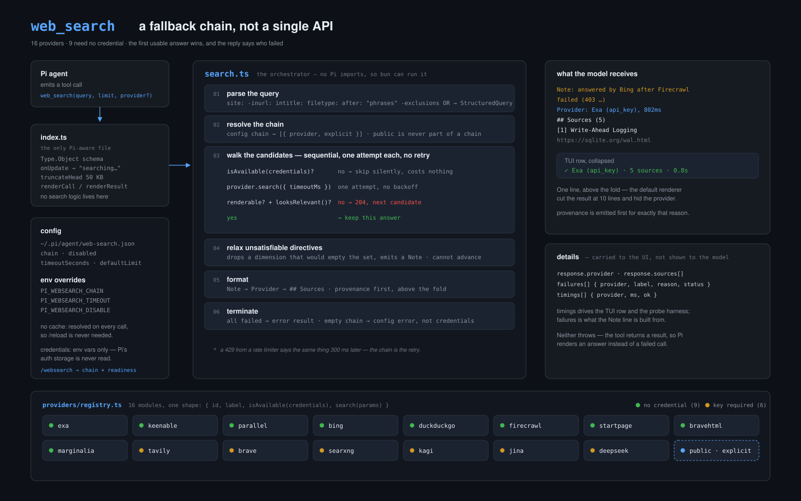
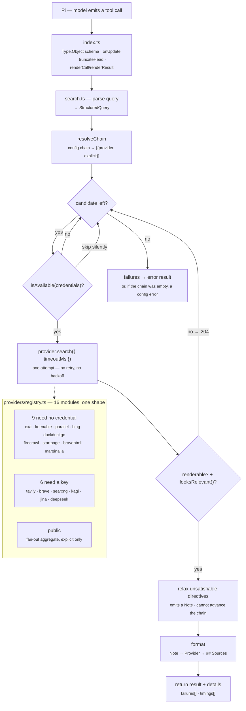

# Architecture

Two views of the same thing: a rendered diagram, and a Mermaid source you can
edit. Both describe the code as it is, not as it was planned.

The rasterised copy is [`architecture.png`](./architecture.png) for renderers
that do not handle SVG.

## Diagram source

## Reading order

| Layer | File | Why it exists |
|---|---|---|
| Pi glue | `index.ts` | Schema, partial-result updates, output truncation, TUI renderers, `/websearch`. No search logic. |
| Orchestrator | `search.ts` | The chain walk, the guards, formatting, provenance. Imports nothing from `@earendil-works/*`, so it runs under `bun`/`node`. |
| Config | `config.ts` | Chain order, limits, timeouts, credentials. Resolved per call. |
| Query | `query.ts` | Directive parser, per-engine query formatting, lenient constraint filter, relevance guard. |
| Providers | `providers/*.ts` | One module per engine, all shaped `{ id, label, isAvailable, search }`. |

## The three facts worth remembering

1. **One attempt per candidate.** There is no retry or backoff anywhere. A `429`
   from a rate limiter says the same thing 300 ms later, so the chain — 16
   independent providers — is the retry.
2. **`204` is the failure signal for "answered, but unusable".** A provider that
   returns nothing, or returns results unrelated to the query, throws `204` and
   the chain advances exactly as if it had errored.
3. **Two things look like fallback but are not.** Constraint relaxation runs
   *after* a candidate has already won and can only annotate the answer.
   `looksRelevant` runs before and is a veto that re-enters the fallback loop.
